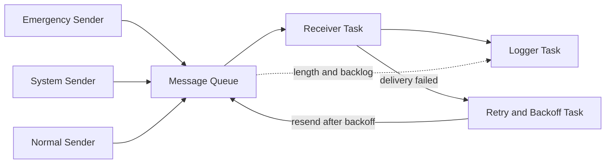

# PriorityLink
## By team SignalGuardians

**Making sure the most critical message always gets through.**

PriorityLink is a priority-based spacecraft communication system built on FreeRTOS. It is the Team 3 "Signal Guardian" project for the OS PBL class, Task 1: Spacecraft Communication System.

## The problem

During a docking maneuver, a spacecraft receives a flood of routine telemetry just as a critical fault alarm arrives. The alarm must not wait behind the data. Generic messaging treats all traffic alike, so urgent messages can be delayed or lost under load, putting crew and mission at risk.

## The idea

Let the operating system decide who gets through.

- **Messages are ranked by urgency:** Emergency, System and Normal.
- **Priority scheduling and queues** keep Emergency messages first, even when routine traffic spikes.
- **Retry with backoff** recovers failed deliveries.
- **Encrypted, timestamped logs** prove what happened and make failures auditable.

### Message types

| Type | Example | Priority | Processing rule |
| --- | --- | --- | --- |
| Emergency | Fault alarm, abort command | High | Processed first, immediate retry |
| System | Subsystem status and health | Medium | Processed after Emergency messages |
| Normal | Routine telemetry, general messages | Low | Processed when the CPU is free; may wait in the queue |

## How it works



1. A sender creates a message and encrypts its payload with XOR.
2. The message goes into the shared queue.
3. The receiver takes the highest-priority message, decrypts it and checks integrity.
4. If delivery fails, the retry task resends it after a backoff delay (Emergency is retried immediately).
5. The logger records every event with a timestamp, plus queue length and failures.

The architecture has three layers: **Ingest** (senders and encryption), **Deliver reliably** (queue, receiver, retry) and **Monitor and trace** (logger).

## Operating system concepts

- **Scheduling:** task priorities decide which task runs first.
- **IPC:** queues carry messages between tasks.
- **Synchronization:** no lost or corrupted data.

## Project structure (proposed)

This layout is a proposal. Adjust it to match the real repository.

```
├── README.md
├── docs/
|   ├── index.html
|   ├── design/
│       ├── functional-requirements.md
│       ├── system-architecture.md
│       ├── hld.md
│       ├── lld.md
│       └── test-report.md
├── src/
│   ├── main.c              # project skeleton: creates tasks and queue
│   ├── message.h / .c      # message structure and the three types
│   ├── queue_comm.h / .c   # shared queue interface
│   ├── sender.c            # Emergency, System and Normal sender tasks
│   ├── receiver.c          # receiver task, processes by priority
│   ├── retry.c             # retry and backoff task
│   ├── crypto.c            # XOR encryption and checksum
│   └── logger.c            # timestamped logger task
├── test/
│   ├── burst_traffic.c     # burst of Normal messages for load tests
│   └── failure_injection.c # forces delivery failures to exercise retry
└── results/                # experiment logs and measurements
```

| Module | Owner |
| --- | --- |
| Queue-based communication, project skeleton, integration | Woudneh Naomi Eskinder |
| XOR encryption and message integrity | Denis Mathis Ghislain |
| Retry task and backoff logic | Yadav Roshan Kumar |
| Logger task and testing | Mureithi Alvin Kinyua |
| Sender and receiver tasks | Harneet Kaur |
| Message types and priority scheduling | Le Huu Duy |

## Landing page (demo site)
The landing page lives in docs/index.html. It is a single self-contained file (HTML, CSS and a little JavaScript) that covers the problem, solution, architecture, a small priority-ordering illustration, evaluation targes, team and schedule. 

## Building and running

TBD once the simulator and project template are set up (toolchain, build command, how to run the demo).

## How we evaluate it

These targets are proposals and will be tuned after the first experiments.

| Area | Target | How we measure |
| --- | --- | --- |
| Priority correctness | Emergency processed before Normal in 100% of test runs | Compare message order in timestamped logs over repeated runs |
| Responsiveness | Emergency delay of 10 ms or less with 100 Normal messages queued | Send-to-receive time at low and high load |
| Delivery reliability | 99%+ delivered within 3 retries, no silent loss | Inject failures; compare messages sent, delivered and logged |
| System stability | No queue overflow or task starvation under peak load | Peak queue depth, stack high-water marks, Normal-message wait time |

## Constraints and scope

- FreeRTOS on a simulator, no real spacecraft hardware.
- One processor, limited memory and stack per task, so priorities need careful tuning.
- About 5 weeks, final demo on 12/8; six members with mixed RTOS experience.
- Simulated messages and link, no real radio.
- XOR is a demo cipher, not flight-grade security.
- Focus on priority, retry and logging.

## Schedule

| Week | Date | Plan |
| --- | --- | --- |
| Week 11 | 11/10 | Proposal presentation; set up GitHub, Notion, simulator; finish design |
| Week 12 | 11/17 | Create tasks and queues; message types and priorities; first working flow |
| Week 13 | 11/24 | Progress presentation; retry and backoff; logger task |
| Week 14 | 12/1 | XOR encryption; integration and tests; delay and backlog experiments |
| Week 15 | 12/8 | Final tests and demo; completion presentation; GitHub and Notion check |

## Team

Team 3 "Signal Guardian": Woudneh Naomi Eskinder (leader), Denis Mathis Ghislain (co-leader), Yadav Roshan Kumar, Mureithi Alvin Kinyua, Harneet Kaur, Le Huu Duy.

## References

- FreeRTOS website: https://www.freertos.org/
- Mastering the FreeRTOS Real Time Kernel: A Hands-On Tutorial Guide, and its companion source code
- FreeRTOS Reference Manual
- Operating Systems textbook (Life and Power Press)
- Lecture slides: Process, Thread, Concurrency, Processor Scheduling
- Project task description (LMS)
