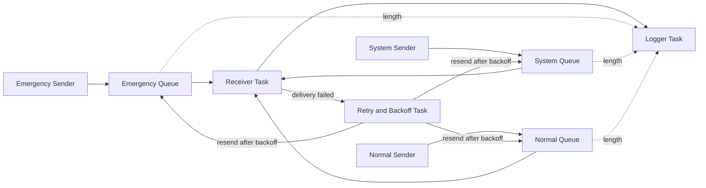

# PriorityLink

**Making sure the most critical message always gets through.**

PriorityLink is a priority-based spacecraft communication system built on FreeRTOS. It is the Team 3 "Signal Guardian" project for the OS PBL class, Task 1: Spacecraft Communication System.

Repository: https://github.com/naomesk/signalguardians

## The problem

During a docking maneuver, a spacecraft receives a flood of routine telemetry just as a critical fault alarm arrives. The alarm must not wait behind the data. Generic messaging treats all traffic alike, so urgent messages can be delayed or lost under load, putting crew and mission at risk.

## The idea

Let the operating system decide who gets through.

- **Messages are ranked by urgency:** Emergency, System and Normal.
- **One queue per priority** keeps Emergency messages first, even when routine traffic spikes. Under overload Normal messages are delayed, never dropped.
- **Retry with backoff** recovers failed deliveries (3 retries at 10, 20 and 40 ms; Emergency is retried at once).
- **Encrypted, timestamped logs** prove what happened and make failures auditable.
- **A live visualizer** shows a flood of Normal traffic and an Emergency message jumping the line (see Live demo).

### Message types

| Type | Example | Priority | Processing rule |
|---|---|---|---|
| Emergency | Fault alarm, abort command | High | Processed first, immediate retry |
| System | Subsystem status and health | Medium | Processed after Emergency messages |
| Normal | Routine telemetry, general messages | Low | Processed when the CPU is free; may wait in the queue |

## How it works



1. A sender creates a message, encrypts its payload with XOR, then sets a checksum (`Sec_Seal`).
2. The message goes into the queue for its priority.
3. The receiver takes the highest-priority message (Emergency, then System, then Normal), verifies the checksum, then decrypts (`Sec_Open`).
4. If delivery fails, the receiver reports it once to the retry task, which resends after a backoff delay (Emergency immediately). After the third retry the message is logged as FAILED.
5. The logger records every event with a timestamp and the three queue lengths.

The architecture has three layers: **Ingest** (senders and encryption), **Deliver reliably** (queues, receiver, retry) and **Monitor and trace** (logger).

### Task priorities

| Task | Priority |
|---|---|
| Emergency sender | 5 |
| Receiver | 5 |
| System sender | 4 |
| Retry | 3 |
| Command task (demo only) | 3 |
| Normal sender | 2 |
| Logger | 1 |

### Log line format

```
[tick] [TYPE] [EVENT] id=<id> retries=<n> qE=<n> qS=<n> qN=<n>
```

With `LOG_JSON` set to 1 in `config.h`, the logger prints one JSON object per line instead (used by the demo viewer):

```
{"t":1042,"type":"E","ev":"RECEIVED","id":57,"r":0,"qE":0,"qS":1,"qN":14}
```

## Operating system concepts

- **Scheduling:** task priorities decide which task runs first.
- **IPC:** queues carry messages between tasks.
- **Synchronization:** no lost or corrupted data.

## Modules

Each module has one owner, one header and one stub, so modules can be built separately. All constants live in `config.h`.

| Module | What it does | Owner |
|---|---|---|
| M1 Message types | `msg.h`, `config.h`: message format, constants, priorities | Le Huu Duy |
| M2 Queue | Three queues plus a queue set; the only place ordering is decided | Woudneh Naomi Eskinder |
| M3 Security | XOR encryption, checksum, `Sec_Seal` and `Sec_Open` | Denis Mathis Ghislain |
| M4 Senders | Three sender tasks, burst generator, demo command task | Harneet Kaur |
| M5 Receiver | Receiver task and failure injection | Harneet Kaur |
| M6 Retry | Retry task and backoff | Yadav Roshan Kumar |
| M7 Logger | Log queue, text and JSON log formats, stack report | Mureithi Alvin Kinyua |
| M8 Application | `main.c`, task creation, integration | Woudneh Naomi Eskinder |
| M9 Demo (proposed owner) | Bridge program and viewer page, outside FreeRTOS | Le Huu Duy |

Full design documents are in the team Notion workspace: Functional Requirements, System Architecture, High-Level Design, Low-Level Design, Demo Plan and R&R.

## Project structure (proposed)

This layout is a proposal. Adjust it to match the real repository.

```
signalguardians/
├── README.md
├── docs/                   # GitHub Pages source
│   └── index.html          # landing page with live demo section
├── src/
│   ├── main.c              # M8: creates tasks in order
│   ├── config.h            # M1: every constant
│   ├── msg.h / msg.c       # M1: message type and ID counter
│   ├── queue.h / .c        # M2: three queues + queue set
│   ├── security.h / .c     # M3: XOR, checksum, Sec_Seal, Sec_Open
│   ├── senders.h / .c      # M4: sender tasks, Burst_Start
│   ├── demo.h / demo.c     # M4: command task (demo_cmd.txt)
│   ├── receiver.h / .c     # M5: receiver, failure injection
│   ├── retry.h / .c        # M6: retry and backoff
│   └── logger.h / .c       # M7: text and JSON log
├── demo/                   # M9: live demo (outside FreeRTOS)
│   ├── bridge.py           # runs the simulator, streams events, sends commands
│   ├── viewer.html         # animated queues and Emergency flash
│   └── sample_run.jsonl    # recorded run for replay mode
├── test/                   # per-module tests with stubs
└── results/                # experiment logs and measurements
```

## Live demo

The final demo is a live flood test. The simulator prints one JSON line per event, a small Python bridge forwards them to a browser page, and the page animates the three queues, the receiver and the Emergency message.

- **Start flood** sends 100 Normal messages as fast as the queue allows.
- **Send Emergency** (pressed by a volunteer from the audience) sends one Emergency message during the flood. The page shows it jumping the Normal lane, its delay in ms and how many Normal messages it skipped.
- **Replay mode** plays back a saved `run.jsonl` without the simulator. This is the backup if the live run fails.

How it connects: the bridge writes a letter (`E` or `B`) into `demo_cmd.txt`; the command task in the simulator reads it every 50 ms and acts. Delays are computed from the simulator's tick timestamps (1 tick = 1 ms), never from the browser. The page shows only real events, never made-up data.

Commands (once the demo files exist; names may change):

```
python demo/bridge.py                      # live: starts the simulator and the page
python demo/bridge.py --replay demo/sample_run.jsonl   # replay only
```

## Landing page (GitHub Pages)

The landing page lives in `docs/index.html`. It is a single self-contained file that covers the problem, solution, architecture, project progress, final design, the live demo, evaluation targets, team and schedule.

To publish it with GitHub Pages:

1. Push the repository to GitHub.
2. Open **Settings, Pages**.
3. Under **Build and deployment**, choose **Deploy from a branch**, select the `main` branch and the `/docs` folder, then save.
4. The site appears at `https://naomesk.github.io/signalguardians/` after a minute or so.

To preview it locally, open `docs/index.html` in a browser.

To show live Notion pages on the site, publish the page in Notion (Share, Publish to web) and paste the link into the `NOTION` block near the end of `docs/index.html`.

## Building and running

Platform: FreeRTOS Windows MSVC simulator port, language C. Toolchain steps and the exact build command are still to be written once the project template is final.

## How we evaluate it

These targets are fixed. They have not been measured yet; results come from the Week 14 experiments.

| Area | Target | How we measure |
|---|---|---|
| Priority correctness | Emergency processed before Normal in 100% of test runs | Compare message order in timestamped logs over repeated runs |
| Responsiveness | Emergency delay of 10 ms or less with 100 Normal messages queued | Send-to-receive time at low and high load |
| Delivery reliability | 99%+ delivered within 3 retries, no silent loss | Inject failures (`FAIL_PERCENT`, fixed seed); compare sent, delivered and logged |
| System stability | No queue overflow or task starvation under peak load | Peak queue depth, stack high-water marks, Normal-message wait time |
| Demo fidelity | The viewer never changes the measured results | Delays come from tick timestamps; logger stays lowest priority |

## Constraints and scope

- FreeRTOS on a simulator, no real spacecraft hardware.
- One processor, limited memory and stack per task, so priorities need careful tuning.
- About 5 weeks, final demo on 12/8; six members with mixed RTOS experience.
- Simulated messages and link, no real radio.
- XOR is a demo cipher, not flight-grade security.
- Focus on priority, retry and logging, plus a live demo visualizer.

## Schedule

| Week | Date | Plan |
|---|---|---|
| Week 11 | 11/10 | Proposal presentation; set up GitHub, Notion, simulator; finish design |
| Week 12 | 11/17 | Create tasks and queues; message types and priorities; first working flow |
| Week 13 | 11/24 | Progress presentation; retry and backoff; logger task |
| Week 14 | 12/1 | XOR encryption; integration and tests; delay and backlog experiments; demo build (JSON log, command task, bridge, viewer) |
| Week 15 | 12/8 | Record backup run, rehearse demo twice, final tests and demo; completion presentation; GitHub and Notion check |

## Team

Team 3 "Signal Guardian": Woudneh Naomi Eskinder (leader), Denis Mathis Ghislain (co-leader), Yadav Roshan Kumar, Mureithi Alvin Kinyua, Harneet Kaur, Le Huu Duy.

## References

- FreeRTOS website: https://www.freertos.org/
- Mastering the FreeRTOS Real Time Kernel: A Hands-On Tutorial Guide, and its companion source code
- FreeRTOS Reference Manual
- Operating Systems textbook (Life and Power Press)
- Lecture slides: Process, Thread, Concurrency, Processor Scheduling
- Project task description (LMS)
